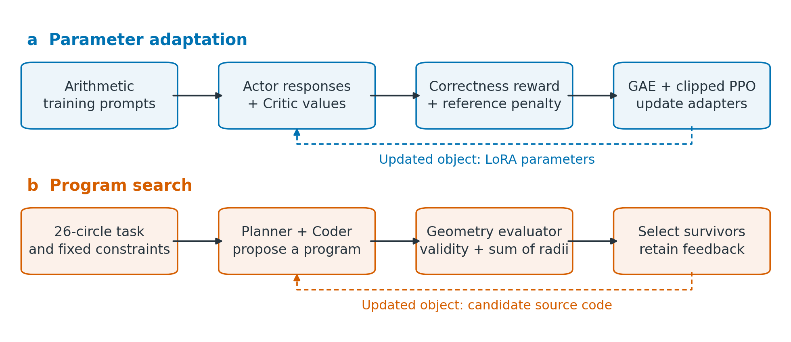
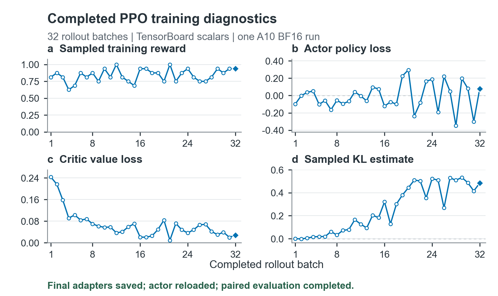
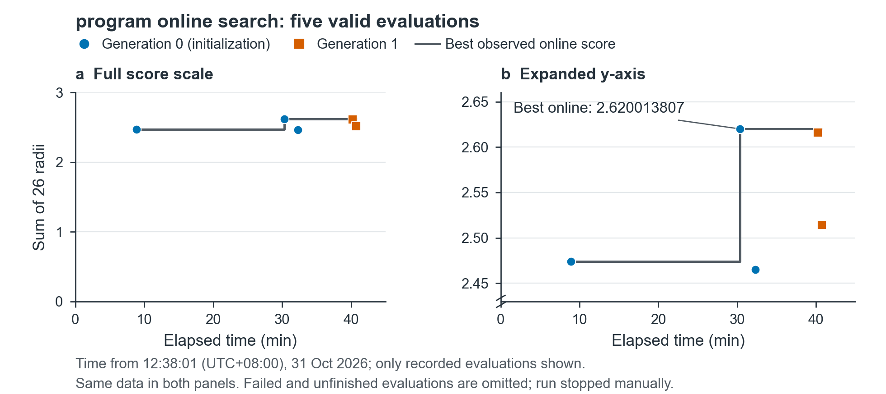
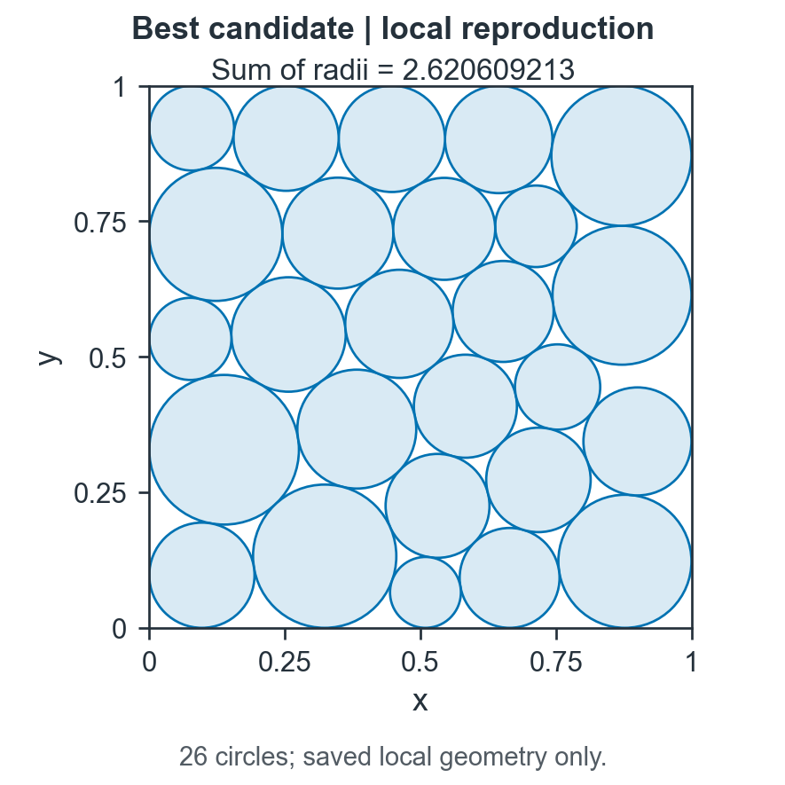

English | [简体中文](README.zh-CN.md)

# Feedback-Guided Optimization of Language Models and Programs

Two small-scale empirical studies of executable feedback: adapting a Qwen policy with LoRA-PPO, and searching for a program that packs 26 circles into a unit square. This repository provides selected implementations, recorded responses and metrics, saved adapters, editable figures, and bilingual research reports. It documents observed behavior rather than claiming a new optimization algorithm.



## Research questions

Can a narrowly defined correctness reward improve a small language model on a matched arithmetic validation set? Can executable geometric feedback identify a useful circle-packing constructor? What do training curves, successful serialization, and independent program execution each establish?

## Methods

- **Policy adaptation:** a manual LoRA implementation and behavior tests; a separate PEFT/OpenRLHF Actor-Critic PPO experiment using `Qwen/Qwen2.5-0.5B`, rank 8, 512 training prompts, and 32 rollout batches. A fixed reference policy supplies the KL penalty. A separate 16-prompt save/reload check precedes the full run.
- **Program search:** a recorded LLM4AD_Next/OpenLoopX run generates Python constructors. A fixed evaluator checks boundary and pairwise constraints, then scores the sum of radii. The selected generated program combines deterministic starts, SLSQP, and radius allocation by linear programming.

## Experiments and results

| Record | Observed result | Scope |
|---|---|---|
| A10 BF16 policy experiment | 117/128 → 122/128 correct; **+3.90625 percentage points** | Same questions and greedy evaluation; one seed |
| Saved policy | Actor and Critic adapters saved; Actor reloaded and executed | Critic weights inspected, not independently reloaded |
| Historical T4 experiment | 32 rollout batches, followed by final serialization failure | Separate FP32 baseline; no recovered trained-policy evaluation |
| Online program search | Five valid evaluations among seven proposals; best **2.62001380699489** | Best observed candidate came from initialization |
| Independent local execution | Sum of radii **2.6206092130170973**, 26 valid circles | A different execution record, not a replacement online score |







All numerical plots use saved data. Packing plots preserve saved centers, radii, and equal axis scale. The feedback-loop illustration above is a conceptual diagram.

## Analysis and limitations

The policy gain is five corrected answers on a **development-validation** set: its scoring protocol was revised after inspecting responses. This is not a held-out general-reasoning benchmark. Different sampled rollout batches cannot substitute for matched validation. One seed, one narrow task, and no hyperparameter ablation limit causal and statistical conclusions. No complete PPO optimizer/resume checkpoint is supplied. The saved Critic adapters also omit the underlying initialized value-head weight, so they cannot independently restore the full trained value function. This does not affect the verified Actor reload or its paired evaluation.

The short online search was stopped manually. Later observed generations did not beat the initialization winner; convergence and global optimality are not established. The small online/local numerical difference has not been isolated. The two scores remain separate throughout the data and reports.

## Reports and source

| Language | Online PDF preview | Direct download | Editable source |
|---|---|---|---|
| English | [Research report](reports/report-en.pdf) | [Download PDF](reports/report-en.pdf?raw=true) | [LaTeX](reports/source/report-en.tex) |
| 简体中文 | [中文研究报告](reports/report-zh.pdf) | [下载 PDF](reports/report-zh.pdf?raw=true) | [LaTeX](reports/source/report-zh.tex) |

- [Policy implementation and reproduction](policy_adaptation/README.md)
- [Program-search implementation and reproduction](program_search/README.md)
- [Editable plotting scripts](figure_tools/README.md)
- [Environment and basic checks](docs/REPRODUCIBILITY.md)
- [Record selection and transformations](docs/PROVENANCE.md)
- [Third-party sources and terms](LICENSES.md)

## Quick checks

Saved-data checks require no GPU, model download, or online LLM account:

```sh
python -m unittest discover -s tests -p "test_records.py" -v
```

For a fresh CPU execution of the selected packing constructor:

```sh
python -m pip install -r program_search/requirements.txt
python program_search/solve.py
```

For the manual LoRA behavior tests, use a separate environment with the dependencies listed in the policy module:

```sh
python tests/test_policy.py
```

Full PPO reproduction needs a suitable Linux NVIDIA GPU and the pinned environment. It is optional and is **not** started by any quick-check command. The packaged eager setup recipe was not retested on a clean GPU machine during publication preparation.

## References

Methods build on [LoRA](https://arxiv.org/abs/2106.09685), [PPO](https://arxiv.org/abs/1707.06347), [Qwen2.5](https://huggingface.co/Qwen/Qwen2.5-0.5B), [OpenRLHF](https://github.com/OpenRLHF/OpenRLHF), and [LLM4AD_Next](https://github.com/Optima-CityU/LLM4AD_Next). Exact revisions and detailed references appear in the reports and provenance notes. The packing winner is attributed to the recorded LLM-assisted search.

