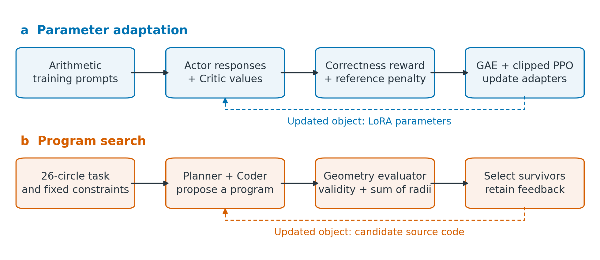
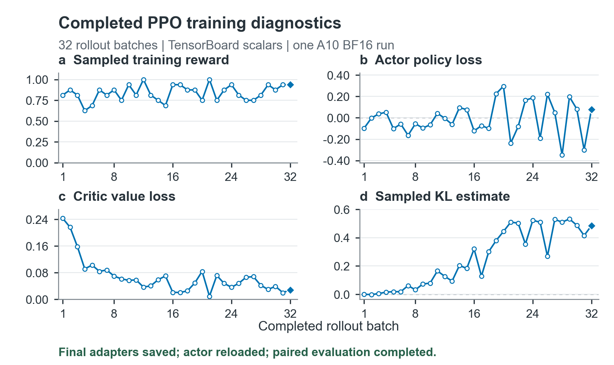
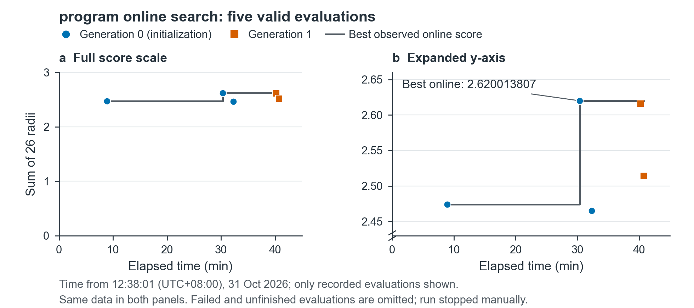
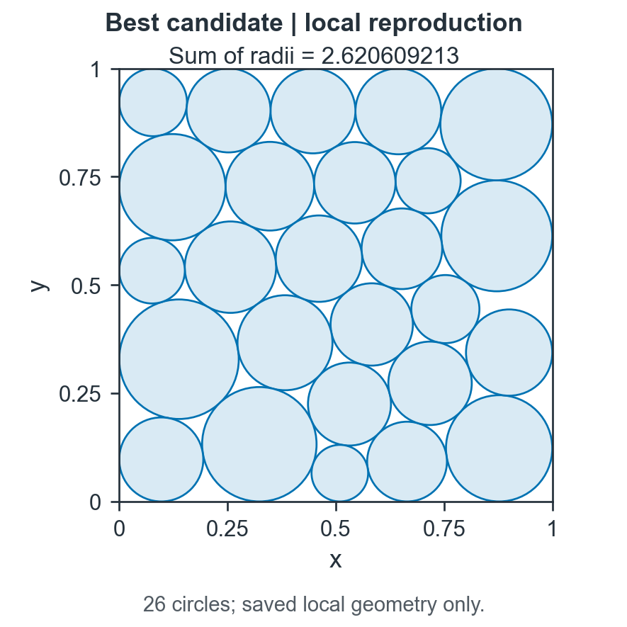

[English](README.md) | 简体中文

# 反馈驱动的语言模型与程序优化

本项目整理了两个小规模实证案例：用 LoRA-PPO 调整 Qwen 模型的回答行为，以及用可执行的几何评估搜索 26 圆装填程序。提供共用的一套代码、保存的实验数据与适配器、可编辑绘图脚本，以及最终中英文研究报告。研究重点是如何验证反馈是否带来实际改善，不声称提出新的优化算法。



## 研究问题

第一个案例研究：对整数加法使用明确的正确性奖励，能否提高小模型在同一组问题上的正确率？第二个案例研究：让语言模型提出程序，再执行程序检查圆是否越界或重叠，能否得到较好的装填方案？两个案例也共同检查：训练曲线、模型成功保存和程序独立执行，分别能支持什么结论。

## 方法与原理

### 语言模型适配

LoRA 冻结原模型的权重，只训练两个较小矩阵。公开代码包含手工 LoRA 层、层替换和合并，以及检查数值等价、真实参数更新和奖励接口的测试。这部分与正式 PPO 中使用的 PEFT 实现分别说明。

正式实验使用 `Qwen/Qwen2.5-0.5B`。Actor 负责生成回答；Critic 估计未来回报；固定参考模型提供 KL 约束，限制策略偏离。PPO 根据奖励和优势估计调整适配器。先用独立的 16 题实验检查保存和重新加载，再从原始模型重新开始 512 题、32 个 rollout 批次的完整实验。

奖励按回答第一行的整数是否正确计算。训练奖励来自不同批次的抽样回答，不能直接当作同一套题目上的正确率变化。报告另外使用相同 128 道题、相同贪心解码及评分方式进行训练前后配对比较。

### 程序搜索与圆装填

目标是在单位正方形内放置 26 个不重叠圆，使半径之和尽可能大。在线系统提出代码、执行代码、检查几何约束，并将评分反馈给后续搜索。保留的最佳程序由该在线搜索生成，组合多组确定性初始布局、SLSQP 优化和固定圆心后的线性规划半径分配。

“半径分配子问题求解成功”不等于“整个圆心布局全局最优”。绘图直接读取保存的圆心和半径，保持横纵轴等比例，没有从图片猜测几何位置。

## 实验结果

| 记录 | 实际结果 | 必须区分的范围 |
|---|---|---|
| A10 BF16 完整 PPO | 正确数 117/128 → 122/128，增加 **3.90625 个百分点** | 同一组开发验证问题，只有一个随机种子 |
| 模型保存与恢复 | Actor/Critic 适配器保存；Actor 实际重新加载并执行 | Critic 只检查权重，未单独重新加载；无完整优化器恢复状态 |
| 较早 T4 实验 | 32 批 rollout 完成，但最终模型保存失败 | 属于不同 FP32 记录，不能替代 A10 基线，也没有可靠的训练后评估 |
| 在线程序搜索 | 七个提案中五次有效评估；最佳 **2.62001380699489** | 最佳值来自初始化阶段，后续已观察候选未超过它 |
| 独立本地复现 | 26 个圆几何有效，半径和 **2.6206092130170973** | 属于另一条执行记录，不覆盖在线最佳值 |







## 结果分析与局限

PPO 的提升是五道问题从错到对。验证评分方式曾在查看回答后调整，因此这些结果属于**开发验证**，不能当作完全未见过的测试集。一个种子、一个小型合成任务、没有超参数消融，也不足以推断一般推理能力或哪个参数导致提升。

Critic 导出文件保留了 LoRA 矩阵，但缺少底层随机初始化的价值头权重，不能单独恢复完整的已训练价值函数；这不影响已验证的 Actor 重载及其配对评估。

训练曲线中的奖励、Actor 损失、Critic 损失和估计 KL 含义不同，不能只看某条曲线下降就断言模型更正确。估计 KL 的小负值不代表理论 KL 为负。报告解释了这些区别，并保留了早期最终保存失败及后续成功恢复的事实。

在线搜索在执行过程中被手动停止，不能声称完成全部预算、搜索收敛或达到最优。其全局最佳候选在初始化阶段已经出现。在线与本地得分的小差异尚未隔离原因，因此两条记录分别展示。

## 阅读报告与代码

| 内容 | 在线预览 | 直接下载 | 可编辑源码 |
|---|---|---|---|
| 英文研究报告 | [预览 PDF](reports/report-en.pdf) | [下载 PDF](reports/report-en.pdf?raw=true) | [LaTeX](reports/source/report-en.tex) |
| 中文研究报告 | [预览 PDF](reports/report-zh.pdf) | [下载 PDF](reports/report-zh.pdf?raw=true) | [LaTeX](reports/source/report-zh.tex) |

- [语言模型模块](policy_adaptation/README.zh-CN.md)：实现、依赖、测试、训练和评估命令。
- [程序搜索模块](program_search/README.zh-CN.md)：候选程序、固定评估器、几何校验及在线/本地记录。
- [绘图脚本](figure_tools/README.md)：读取已有数据生成 PDF 和 PNG。
- [复现环境与检查范围](docs/REPRODUCIBILITY.md)。
- [版本取舍与数据处理说明](docs/PROVENANCE.md)。
- [第三方来源与许可](LICENSES.md)。

## 如何运行

先运行保存数据的检查，不需要 GPU、模型下载或平台账号：

```sh
python -m unittest discover -s tests -p "test_records.py" -v
```

本地执行最佳圆装填程序只需要 CPU 和数值计算依赖。它会重新计算一个布局；新结果可能因依赖版本而略有变化，不会变成新的在线成绩：

```sh
python -m pip install -r program_search/requirements.txt
python program_search/solve.py
```

检查手工 LoRA 行为时，另建环境并按语言模型模块安装依赖，然后运行：

```sh
python tests/test_policy.py
```

完整 PPO 需要 Linux NVIDIA GPU 和固定版本的依赖，应使用独立环境，避免与绘图/几何环境的 NumPy 版本冲突。这里的快速检查不启动完整训练。公开版安装脚本整理自实际恢复路径，但发布时没有重新验证一台全新 GPU 机器上的完整安装过程。

## 方法来源

项目基于 [LoRA](https://arxiv.org/abs/2106.09685)、[PPO](https://arxiv.org/abs/1707.06347)、[Qwen2.5](https://huggingface.co/Qwen/Qwen2.5-0.5B)、[OpenRLHF](https://github.com/OpenRLHF/OpenRLHF) 和 [LLM4AD_Next](https://github.com/Optima-CityU/LLM4AD_Next)。固定提交版本和必要引用见报告与来源说明；在线生成候选不被表述为手写原创算法。

